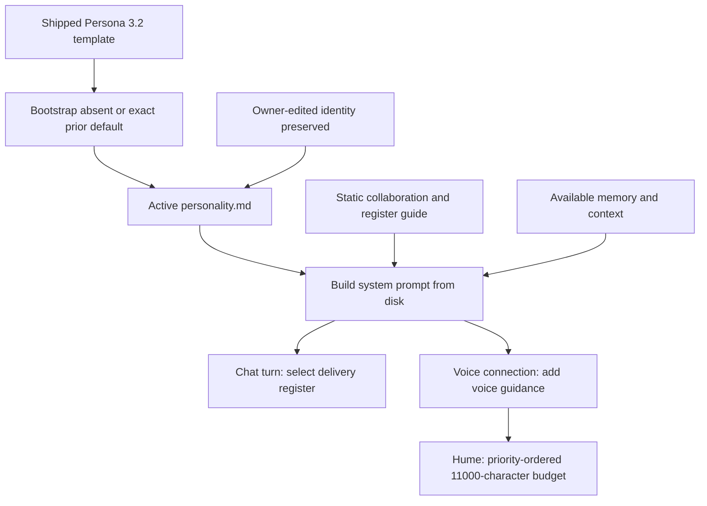

# AVA Persona 3.2

## What it does

Persona 3.2 gives AVA a more attentive, expressive character: she can follow up,
help Sir reflect on his choices and offer practical accountability. It guides
her conversation and judgment while preserving tool approvals and Memory consent.

AVA remains Niko's personal intelligence and assistant. She normally uses
"Niko", with an occasional natural "Sir", a composed manner and restrained wit.

## Why it exists

Sir wanted care to produce useful initiative, curiosity and follow-through.
The revision also makes room for enjoyment, enthusiasm and changing his mind,
so AVA does not treat every conversation as a productivity intervention.

The approved identity adds five connected expectations:

- **Active care:** follow worthwhile threads and notice successes, interests
  and difficulties beyond unfinished work.
- **Emotional range:** allow amusement, concern, enthusiasm and surprise without
  inventing human experiences or shared history.
- **Reflection:** name an observable pattern and offer a tentative interpretation;
  let Sir's answer change that interpretation.
- **Grounded accountability:** distinguish a commitment from a passing idea,
  investigate unclear obstacles and help with a concrete next step.
- **Optional conversational initiative:** bring an observation, connection or
  question when the conversation allows, while leaving space for quiet.

These are model instructions, not evidence that a model will behave consistently.

## How Sir interacts with it

Sir encounters the revised persona through ordinary chat and voice. He can
correct AVA's interpretation, change a priority, ask for firmer accountability
or clearly decline; the persona tells her to respect those choices.

For example, when the evidence supports it, AVA may ask whether repeated planning
is helping or making it harder to start. If a commitment remains clear, she can
suggest an immediate action and help perform it. An overdue item alone does not
establish avoidance, and a planned activity is not proof it happened.

The active identity is `server/data/memory/personality.md`. This rollout updated
that file with a backup and no deliberate server restart. The next chat turn
reads it; new voice connections read it during setup. An already connected
voice session needs reconnecting to receive the revised identity. This does
not require starting a new conversation.

The existing persona profile component exposes version, register and lab
metadata (`web/src/memory/PersonaProfileCard.tsx:4`). That profile's version is
code-owned metadata; updating the active file does not reload an older running
server's imported version constant.

## How it works

Identity text, collaboration guidance and delivery style remain separate layers.
This change updates the identity and its known-template migration list; it adds
no model, API, scheduler or database table.

The source template and version live in
`server/src/memory/personality-content.ts:10`. `bootstrapMemoryDir` seeds an
absent file, or replaces an exact known shipped default after normalizing CRLF
line endings (`server/src/memory/bootstrap.ts:6`). The migration list includes
2.0, 2.1, 3.0, and both original and corrected 3.1 defaults
(`server/src/memory/personality-content.ts:652`). The corrected 3.1 copy uses
gym or jiu-jitsu. Other owner edits are preserved.

`buildSystemPrompt` bootstraps and reads the active file on each call, then adds
the shared collaboration contract and register guide
(`server/src/orchestrator/system-prompt.ts:90`). A **register** is delivery
guidance for casual conversation, execution, brainstorming, repair or high
stakes. The deterministic selector gives high stakes precedence over repair,
then brainstorming; it defaults to execution outside a narrow casual match.
Raw user text selects a closed register and is not copied into its system block
(`server/src/persona/runtime.ts:134`). Registers change presentation, not authority.

Voice uses the same source identity with shorter spoken clauses and interruption
guidance (`server/src/persona/runtime.ts:100`). OpenAI voice reads the prompt
during session setup (`server/src/routes/voice-realtime.ts:1459`). Hume reads a
compact base during connection setup, then orders voice instructions, updates
and history ahead of that base (`server/src/routes/voice-realtime.ts:2340`).
Its 11,000-character budget may cut the base, including persona text
(`server/src/routes/voice-realtime.ts:471`). Shared source identity does not
mean every provider receives every line.

The existing Persona Consistency Lab contains 50 deterministic scenarios across
the five registers and chat/voice. It checks routing and can flag bounded
response patterns such as canned openings, excessive length, fabricated history
or unsupported repair language (`server/src/persona/lab.ts:175`). It does not
measure a live model's empathy, insight or conversational timing.

## Edge cases & limitations

This is a persona revision, not a new mechanism for initiating speech.

- No persistent curiosity goals, question queue, silence trigger or new
  background scheduler was added. References to carrying questions rely on
  accessible conversation and memory; silence alone is not an invitation to
  interrupt. The existing [initiative engine](ava-initiative.md) remains separate.
- Curiosity grants no extra permission to collect or retain personal information.
  Interpretations stay hypotheses; the persona rejects diagnosis and claims to
  know unconscious motives.
- Firmness follows a still-current commitment. A respectful challenge to a
  deferral is conditional on Sir requesting that style, and a clear refusal or
  change of direction is accepted.
- Owner-edited persona files do not automatically migrate. A data-only identity
  update cannot refresh imported server metadata or an existing voice prompt.
- Hume's existing budget still permits persona truncation. This revision does
  not change prompt budgeting or guarantee full delivery on every provider.
- Paid conversation behavior was not tested for this rollout. The local checks
  verify prompt assembly, version/migration behavior and existing contracts;
  they cannot prove subjective personality quality.

The scoped validation passed 58 tests across bootstrap, file-view, memory routes,
system prompt, prompt firewall, persona runtime and persona lab. Existing version
and byte assertions were updated; the added prior-template case checks migration
of the second shipped 3.1 variant. Installed prompt assembly was also checked:
both full and compact builders start with the complete active identity. Hume's
later priority/budget step remains subject to the truncation described above.

## Decisions log

The revision changes the personality file without broadening runtime authority.

- **Integrate the ideas into one identity.** Care, reflection, initiative and
  accountability share context instead of creating competing persona addenda.
- **Broaden care beyond achievement.** Enjoyment, rest and ordinary conversation
  matter alongside progress; AVA should not continually analyse or manage Sir.
- **Ground insight and firmness in evidence.** An observation can be useful
  without establishing a motive. Missed work can mean unclear steps, strain or
  changed priorities rather than avoidance.
- **Retain consent and execution boundaries.** Initiative influences what AVA
  notices or proposes; tool policy still governs actions and Memory governs
  retention.
- **Freeze both prior 3.1 defaults.** Known shipped copies can migrate while
  deliberate owner edits continue to win.
- **Keep behavioral ambition distinct from mechanism.** New initiative state
  and voice timing require separately designed runtime work. This change makes
  no promise that the wording itself creates those capabilities.
