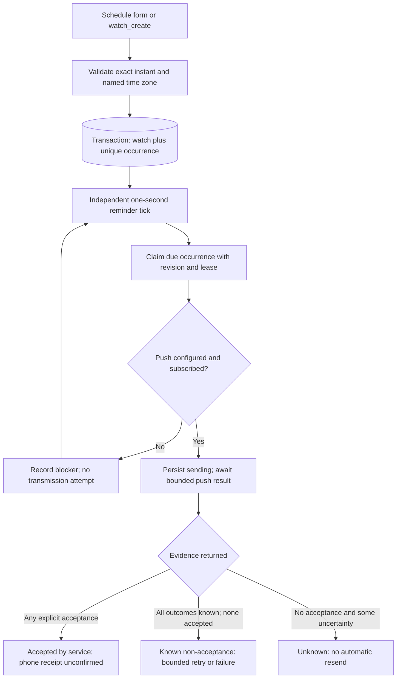

# One-off reminders — exact times and truthful receipts

## What it does

AVA saves a reminder for one exact time and records whether the notification
service accepted it. It does **not** claim that Sir's phone displayed it or that
the underlying task was completed.

**I4 integration status:** this backend increment is separate from the Schedule,
Today and Watches frontend increment, which is still in progress. The interface
described below is that paired implementation, not yet a claim of an accepted
integrated release. Both agents' integrated acceptance and a real phone check
remain separate gates.

This receipt applies to `kind=reminder` watches with an absolute `run_at`. Ordinary
monitoring, Codex delivery and legacy recurring reminders keep their existing
paths; see [Watches](watches.md).

## Why it exists

The old reminder path called a notification function without awaiting its result,
wrote “reminder delivered”, then disabled the watch—even when no device had
subscribed. A slow agent check could also delay reminders. The one-off path now
has its own short scheduler loop and durable, evidence-based outcomes.

## How Sir interacts with it

Use **Schedule** to write a reminder and choose a date and time, or ask AVA in
Talk or a voice action. The form names the browser's time zone and shows the
offset; if the clock change makes a time occur twice, Sir chooses which one.
A time skipped by a clock change is rejected instead of silently shifted.
**Save reminder** reports success only after the server responds to its durable
write. Today shows upcoming reminders; Schedule separates upcoming from recent
finished reminders. The existing Watches one-time Reminder form uses the same
time resolver and receipt presentation.

The receipt's wording separates these cases:

| Status | What AVA actually knows |
|---|---|
| Scheduled | Stored for this time; nothing has been accepted yet. A missing push configuration or subscription is explained separately. |
| Trying | The scheduler owns the work or is awaiting transport evidence. |
| Retry scheduled | The previous attempt was definitely not accepted, and a bounded retry is eligible. |
| Accepted by notification service | At least one subscription was explicitly accepted. Phone display remains unconfirmed, including partial fan-out. |
| Could not send | Known rejection is final or retries are exhausted. |
| Expired | The fixed delivery window passed; the recorded reason distinguishes a known setup blocker from no recorded attempt. |
| Acceptance unknown | Sending may have happened, but acceptance is unproven. AVA will not automatically resend. |
| Paused / Pause requested | Paused before sending, or an already-running send cannot be recalled. |
| Delivery not recorded / Status unavailable | There is no usable receipt; old “delivered” prose is not promoted to evidence. |

Schedule supports explicit deletion; pause/resume remains in Watches. Deleting
or pausing cannot recall a notification already handed to the service. A terminal
occurrence is not rearmed by resuming its watch.

A zero-attempt expiry preserves a known pause as its last recorded blocker,
instead of guessing AVA was offline. The UI describes that historical check;
it does not claim the reminder was paused continuously for the whole window.
Resuming a still-pending reminder removes obsolete pause wording from its current
receipt without rewriting stored history. Expiry after a transmission attempt
still reports `delivery_window_expired`, never “nothing was sent”.

If creation loses its response, the UI explains that saving is unconfirmed and
refreshes the list for inspection. It does not retry the POST automatically or
claim a similar-looking row proves that particular request succeeded.

The browser must be registered for push notifications and AVA must remain awake,
online and running. The receipt does not certify iPhone permissions, lock-screen
display or an always-on deployment. Those require a real device check.

User-facing code: `web/src/schedule/ScheduleScreen.tsx:28`,
`web/src/reminders/WhenField.tsx:21`, `web/src/reminders/presenter.ts:110`,
`web/src/watches/WatchesScreen.tsx:152`.

## How it works

One SQLite occurrence owns the delivery state; the model is not in the sending
loop. An **occurrence** means this watch at this exact due time, not a second
copy of its instruction.

### Intake and time

The persisted instant is authoritative; the named zone explains the intended
local time. `POST /api/watches` accepts the existing authenticated contract with
`kind: "reminder"`, `prompt`, integer epoch-millisecond `run_at`, and `time_zone`
(UTC or a valid IANA name such as `Europe/London`). The instant must be future and
no more than 366 days away. `once: true` is optional; `once: false`, an interval
or a daily time alongside an absolute one-off schedule is rejected.

The agent's `watch_create` takes either a numeric `run_in_minutes` or `at` plus
`time_zone`. `at` must include the full date, seconds and an explicit offset, for
example `2026-10-25T01:30:00+01:00` with `Europe/London`. The code validates the
calendar, then round-trips the wall time through that zone. Impossible dates,
daylight-saving gaps and an offset inconsistent with the zone fail; an overlap
requires an explicit valid offset. Bare `at_local` is not accepted for this path.
The browser uses the same principle for its local date/time picker; it does not
guess using the server's time zone.

Validation failures return bounded codes, not an echo of arbitrary input. The
HTTP shape is `{ error: "bad_request", reasonCode }`: `invalid_run_at`,
`run_at_not_future`, `run_at_too_far`, `invalid_time_zone`, or
`conflicting_schedule`. The agent's date form additionally distinguishes
`invalid_at`, `invalid_local_date` and `time_zone_offset_mismatch`.

Sources: `server/src/watches/reminder-schedule.ts:41`,
`server/src/watches/reminder-schedule.ts:73`, `server/src/routes/watches.ts:74`,
`server/src/tools/watches-mcp.ts:67`, `web/src/reminders/time.ts:68`.

### Durable state and recovery

Creating the watch and occurrence is one transaction. The stable occurrence ID
is `reminder:<watch ID>:<due epoch>`; a unique `(watch_id, due_at)` constraint
makes repeated occurrence creation inert. The row stores phase, revision,
lease, due/expiry/attempt timestamps, bounded reason and subscription counts.
It does not duplicate the prompt or retain push payloads.

The scheduler claims up to eight due occurrences per pass. **CAS**—compare and
swap—updates only the expected revision and lease token. A 30-second lease
prevents a second worker from sending the same occurrence concurrently. The
runner rechecks that the watch still exists and is enabled immediately before
persisting `sending` and invoking transport; there is no asynchronous gap
between that final check and invocation.

The state machine uses `scheduled`, `claimed`, `sending`, `retry_scheduled`,
`accepted`, `failed`, `expired` and `acceptance_unknown`. Public receipts collapse
`claimed`/`sending` to `trying`. Disabling a pre-send watch projects `paused`;
an in-flight send stays `trying`, so the UI can say **Pause requested** honestly.
The type also reserves `cancelled`, but current deletion removes the watch and
its receipt rather than creating a retained cancellation event.

After a restart, an expired **claimed** lease can be retried because transport
has not started. An expired **sending** lease becomes `acceptance_unknown`
instead: the service might already have accepted the message. Its fan-out counts
remain zero when no outcome was durably recorded, not an invented count of
failed devices. Stale or late completions cannot update the terminal row.

Sources: `server/src/state/watches.ts:66`, `server/src/state/schema.sql:791`,
`server/src/state/reminders.ts:31`, `server/src/state/reminders.ts:59`,
`server/src/state/reminders.ts:92`, `server/src/state/reminders.ts:133`.

### Delivery bounds and evidence

The delivery window ends **15 minutes after the original due time**. Restarting
does not extend it. Missing configuration or subscriptions is checked again at
most every 15 seconds within that window and records **zero attempts**. A
subscription disappearing between preflight and transport also restores the
previous attempt count rather than counting a call that sent nothing.

One attempt fans out to the existing subscriptions. The deliverer uses a
10-second default wall-clock deadline, configurable in code up to 20 seconds,
and a socket inactivity timeout. The runner also imposes a 20-second ceiling;
both are bounded by the remaining window. Push **TTL**—how long the service may
retain the notification—is explicitly capped to the remaining window, rather
than the library's long default. The notification tag is occurrence-specific.

Only an explicit successful 2xx result proves service acceptance. Known 429/5xx
rejections are transient; other 4xx responses are permanent, with 404/410 also
pruning the dead subscription. Missing/malformed status, transport exceptions,
network errors or timeout are uncertainty. A timeout stops awaiting evidence;
it is **not** proof that the underlying request was cancelled.

Any accepted subscription makes the occurrence terminally accepted, preserving
partial counts without retrying the others. If none was accepted and any outcome
is unknown, automatic retries stop. Only a wholly known-unaccepted attempt with
a transient rejection can retry: after 15 seconds, then 60 seconds, at most
**three transmissions** and never beyond expiry. Counts describe the **latest
attempt's subscriptions**, not cumulative sends or distinct physical devices;
they are cleared when a new transmission begins.

Sources: `server/src/watches/reminders.ts:21`,
`server/src/push/deliver.ts:55`, `server/src/push/deliver.ts:127`,
`server/src/state/reminders.ts:103`, `server/src/state/reminders.ts:110`,
`server/src/state/reminders.ts:150`.

### Readback, privacy and runtime wiring

`GET /api/watches` and creation responses expose optional version-1
`reminder_status`: occurrence/revision, state, timestamps, saved zone, attempts,
aggregate subscription outcomes, reason and `phoneReceipt: "unconfirmed"`.
Internal leases and transport payloads are not part of that projection.
`watch_list` reads the same receipt rather than trusting historical success
text. The HTTP routes use the existing paired-device authentication; there is
no new public receipt endpoint or separate user/project access model.

Reminder text remains ordinary owner data in the existing watch and becomes the
notification body. Do not put credentials or sensitive lock-screen content in
it. Receipt rows contain no endpoints, subscription keys, provider bodies or
raw transport errors; errors reduce to closed operational reason codes.
Deleting a watch cascades to its receipt. This slice adds no independent
retention archive or per-attempt transcript.

The one-second timer starts after the server owns its port even without an LLM
provider. Ordinary watch checks keep their separate 60-second model-gated
timer, so a stuck browser/agent check does not block this reminder loop.

Sources: `server/src/state/reminders.ts:42`, `server/src/routes/watches.ts:46`,
`server/src/index.ts:818`, `server/src/index.ts:915`,
`server/src/watches/scheduler.ts:471`.

## Edge cases & limitations

- **No exactly-once phone promise.** Service acceptance is not display, click or
  acknowledgement. Unknown acceptance is terminal to reduce duplicate risk,
  which can mean a reminder is missed rather than resent speculatively.
- **Creation has no idempotency key.** Two explicit successful POSTs can create
  two watches. The UI prevents repeat submission while saving and does not
  automatically replay an ambiguous request; server occurrence deduplication
  is not request deduplication.
- **AVA must run.** An overdue reminder can still run inside its original
  15-minute window; after it, the receipt expires. “Missed window” proves no
  recorded attempt, not that the PC was definitely asleep. Slow transport can
  delay the next reminder pass, although not behind a separate agent check.
- **Legacy data stays honest.** Unattempted old one-offs receive an occurrence
  lazily, retaining an unknown time zone if none was stored. Already-attempted
  historical rows do not gain fictional receipts. Interval/daily reminders
  remain legacy and are excluded from the new Schedule receipt list.
- **Pause/delete has a boundary.** Before transport, it prevents a send; after
  transport starts, it cannot recall it. Delete removes the receipt too. A
  terminal occurrence cannot be retried by toggling enabled; a new reminder is
  a separate request and may duplicate an uncertain notification.
- **No deadline completion model.** Sending a reminder does not mark coursework,
  an appointment or another real-life task complete. Calendar imports, recurring
  reliability and device acknowledgements are separate increments.
- **Testing boundary.** Deterministic coverage is in
  `server/src/state/reminders.test.ts`, `server/src/watches/reminders.test.ts`,
  `server/src/watches/reminder-schedule.test.ts`, route/tool/push tests and
  `web/src/reminders/`. Exact release test evidence belongs in `coord/BOARD.md`;
  mocked transport and local browser checks do not prove a phone notification.

## Decisions log

- **Extend watches, not a second scheduler service.** Existing authenticated
  creation, deletion and SQLite authority stay intact. A dedicated short timer
  separates direct reminders from model-dependent monitoring without new
  infrastructure.
- **Exact instant plus named zone.** The instant avoids server-local ambiguity;
  the zone preserves understandable display and explicit daylight-saving
  choices. Recurrence is deliberately outside this first contract.
- **Persist before sending; stop on uncertainty.** SQLite cannot atomically
  commit with an external push service. Recording `sending` first and refusing
  blind restart retries favours honest uncertainty over an exactly-once claim.
- **One aggregate receipt, not a delivery archive.** Latest-attempt counts and
  closed reasons are enough to explain the result without retaining endpoints
  or raw provider responses. They cannot reconstruct every prior attempt.
- **Bounded lateness and retries.** A fixed 15-minute window, short transport
  deadline and three-attempt cap prevent old reminders appearing days later.
  Expiry is explicit rather than quietly changing the requested time.
