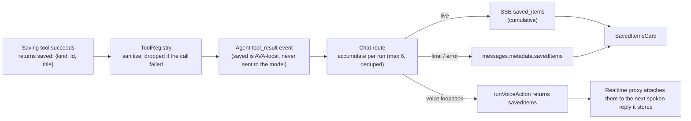

# Saved cards in chat (I3b)

When AVA saves something while answering, her reply shows a small **Saved** card that names exactly what was saved. Each row opens the saved item, so Sir can check it instead of trusting the reply's wording.

The design is deliberately minimal and uses the existing capsule style. It is waiting for Niko's review.

## What Sir sees

```
┌ AVA ─────────────────────────────────────────┐
│ Saved it to your Notes, Sir.                 │
│ ┌ ✓ Saved ─────────────────────────────────┐ │
│ │ 🗒 NOTE      Groceries                  › │ │
│ │ 🔔 REMINDER  Hang the clothes           › │ │
│ └───────────────────────────────────────────┘ │
└───────────────────────────────────────────────┘
```

| Row kind | Created by | Tapping opens |
|---|---|---|
| Note | `notes_capture` (any kind except idea) | Notes, that exact note |
| Idea | `notes_capture` with kind `idea` | Notes, that exact note |
| Reminder | `watch_create`, one-off reminder | Schedule |
| Watch | `watch_create`, anything recurring, or a check/Codex watch | Watches, focused on that watch |
| Memory | `memory_index_capture`, or `memory_remember` appending to preferences, observations or a project file | Memory |

- The card appears on typed chat replies. It also appears on voice replies when the voice turn saved something through a computer action; it shows when Sir opens that conversation in chat.
- A reply that saved nothing has no card.
- A run that saved something and then failed still shows the card under the error.
- Editing an existing note (`notes_update`) or refreshing an observation is not a new save, so it produces no row.

## How it works



- **Model** (`server/src/state/messages.ts`): `{ schemaVersion: 1, items: [{ kind, id, title }] }`.
  - At most 6 items, unique by kind and id.
  - The id must match `^[A-Za-z0-9][A-Za-z0-9:._-]{0,159}$`.
  - The title is secret-scrubbed and cut to 120 characters.
  - The receipt is validated when written and again when read, so a tampered row cannot put an unknown kind or unsafe id into the UI.
- **Producers** report an item only after the write succeeded. The registry drops `saved` from any call that failed.
- **Fast turns**: a run that finishes before the browser's stream connects replays its last `saved_items` event, the same way `memory_context` is replayed.
- **Web**:
  - `useChatStream` listens for `saved_items`.
  - `ChatScreen` maps `metadata.savedItems` from history and promotes the newest live event into the finished reply.
  - `MessageList` renders `SavedItemsCard`.
  - `App` routes a tapped row through `savedItemDestination`.

## Limits
- The voice screen itself shows no card; the card is in the chat transcript of that conversation.
- A voice action's items attach to the next spoken reply AVA stores. If that reply is interrupted before any words, they attach to the following reply.
- One-off reminders open Schedule as a whole; Schedule has no per-reminder focus yet.
- Memory rows open the Memory screen, not a specific entry.

## Tests
- `server/src/state/messages.test.ts`: sanitizer and round trip.
- `server/src/orchestrator/tool-registry.test.ts`: pass-through, and nothing from a failed call.
- `server/src/tools/{notes,watches,memory}-mcp.test.ts`: each producer, only on success.
- `server/src/routes/chat-saved-items.test.ts`: persisted in order, none when nothing was saved, kept after an error, fast-turn replay.
- `server/src/routes/voice-realtime.test.ts`: merging items across voice actions.
- `web/src/chat/{SavedItemsCard,MessageList,ChatScreen.reopen}.test.tsx`, `saved-items.test.ts`, `web/src/App.new-chat.test.tsx`: rendering, live and history paths, and every destination.
