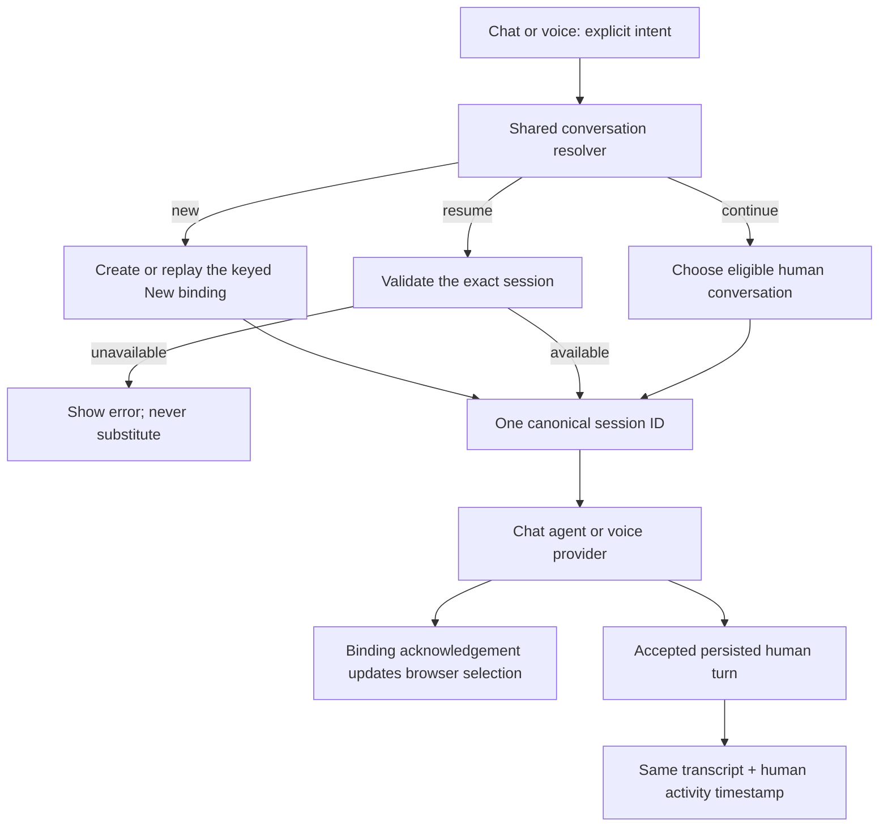

# Voice conversation continuity

## What it does

Sir can switch between typing and speaking in the same selected conversation.
AVA binds both modes to one stored transcript; opening voice does not silently
switch to a newer automated run. Shared history gives the speaking model context,
but does not guarantee perfect or unlimited recall.

## Why it exists

A "most recently updated session" is not necessarily Sir's conversation: a watch,
summary update, or assistant reply can change that timestamp. Earlier voice entry
also resolved the session separately in each provider branch. The shared resolver
makes **New**, **resume this exact conversation**, and **continue a human
conversation** different, explicit requests.

## How Sir interacts with it

- **Home microphone:** continues this browser's remembered conversation. If none
  is remembered, the server chooses an eligible human conversation.
- **Chat microphone / voice Keyboard:** keeps that exact conversation, including
  one first created by a typed message or a voice acknowledgement.
- **Blank New chat / voice "+new":** deliberately creates a fresh conversation.
- **Unavailable conversation:** shows a recovery choice instead of substituting
  another chat. Sir can start New or return to the conversation list.
- **Chats:** shows human conversations first; older unclassified history and
  automated runs remain separately accessible. Automated history is read-only
  and does not replace the current conversational selection.

The browser selection lives in `App` and local storage
(`web/src/App.tsx:195`); the voice hook reports the authoritative binding as soon
as it arrives (`web/src/voice/useRealtimeVoice.ts:1047`).

## How it works

### One binding decision, before a provider starts

`server/src/state/session-binding.ts:63` is the shared SQLite-backed resolver
used by typed chat and the voice proxy:

| Intent | Authoritative behavior |
|---|---|
| `new` | Create a human or automation session according to the trusted caller. |
| `resume` | Validate exactly the supplied ID; missing, deleted, or non-conversational human targets fail without replacement. |
| `continue` | For human callers, select an eligible human conversation by human activity, ignoring pins and background updates; create one if none exists. |

`POST /api/chat` accepts `conversationIntent`; the voice WebSocket accepts
`intent` and still supports the older `sessionId` / `new=1` query.
Contradictory requests fail with 400. Exact unavailable targets produce
`session_unavailable`: HTTP 404 for chat, or `ava.session_error` followed by
WebSocket close 4404 for voice. No rejected ID is included in that error.
See `server/src/routes/chat.ts:298` and
`server/src/routes/voice-realtime.ts:932`.

Voice resolves once before attempting Hume or OpenAI. A pre-open Hume failure
reuses the same binding for OpenAI fallback; a delegated action cannot replace
it with another returned ID. The loopback action acknowledgement must match the
expected session before a stream or cancellation target is chosen
(`server/src/state/session-binding.ts:34`). `ava.session` carries the ID, proxy mode
(`hybrid` or `transcribe`), and versioned binding. Old socket epochs and
mismatched pending-New acknowledgements cannot replace the current selection.

### Human activity is not session maintenance

Sessions have immutable creation `origin` (`human`, `automation`, or
`unknown`) and nullable `last_human_activity_at`
(`server/src/state/sessions.ts:4`). Existing rows migrate to `unknown` with
no inferred timestamp: titles, stored user-role messages, and old modification
times are not proof that a human created them.

Chat classifies the authenticated caller using server-owned
`device_tokens.session_actor`, not a user-editable token label or request flags.
Pairing and migrated tokens default to human; internal token rotation explicitly
stamps watcher credentials as automation and voice-action credentials as
`voice_action` (`server/src/auth/internal-tokens.ts:13`, `:28`). This provenance
does not replace the existing authentication gate.

Only an accepted, persisted human turn advances human activity. Connecting,
binding, seeding, assistant output, title/summary changes, internal tool handoffs,
and rejected busy requests do not. Turn metadata records `inputModality`
separately; exact typed input in voice remains text with
`inputSource: "voice_exact_text"`.

Human continuation includes human-origin sessions and legacy sessions with
subsequent human activity; it excludes archived, deleted, and automation-origin
sessions. Human-origin sessions with no turn yet sort after actual human activity.
Pinned legacy chats are visible in human lists as a preference, but pinning alone
does not make them eligible for automatic continuation. Explicitly choosing a
legacy chat is still supported. Scoped lists are cursor-paginated; absence from
one page never proves that the selected conversation was deleted
(`server/src/state/sessions.ts:75`, `server/src/routes/sessions.ts:10`).

### Retry identity is durable; a binding is not a message send

An optional `bindingRequestId` makes an explicit New request idempotent for one
authenticated device. The resolver uses a SQLite immediate transaction and a
unique device/key pair. Replaying that pair returns the same session, including
after a server restart. The mapping survives session deletion/purge as a
tombstone: retrying it returns unavailable rather than creating another session
(`server/src/state/schema.sql:15`).

The web clients retain their pending key across retries/reconnects within the
mounted screen. They do not persist an unacknowledged key across a full-page
reload, which can leave an empty created conversation visible. This deduplicates
**session creation**, not arbitrary repeated user turns.
Older clients omitting the key do not receive keyed-New idempotency.

### Recall and restart recovery

Hybrid voice seeds the durable conversation summary and bounded recent turns
(default `REALTIME_SEED_TURNS=12`). OpenAI receives conversation items, using
`input_text` for users and `output_text` for assistants; seeding alone does
not request a reply. Its message high-water imports concurrent typed rows at
ordered speech-start/push-to-talk boundaries
(`server/src/routes/voice-realtime.ts:1337`, `:1410`).

Hume gets the summary and recent history in its budgeted prompt on connection.
The source-verified durable memory index is a separate recall layer: OpenAI
retrieves for accepted utterances; Hume retrieves at connection from the latest
stored user turn (`server/src/routes/voice-realtime.ts:1977`, `:2224`).
This is **not universal Hume per-utterance retrieval parity**.

At startup, AVA snapshots unfinished persisted `chat_agent` / `voice_action`
runs and records one interruption notice per run before orphan reconciliation,
in the same transaction. A merely active session or connected voice socket is
not evidence of interrupted work. Notices do not advance human recency or
timestamps, and do not replay the action
(`server/src/state/recovery.ts:8`, `server/src/index.ts:159`). The notice reports
missing completion status, not an absent result: Sir should inspect any saved
result before deciding whether to retry.

## Edge cases & limitations

- **No cross-device current-chat synchronization.** Each browser remembers its
  own selected ID. Exact selection wins over automatic continuation.
- **Not a privacy partition.** Human/automation/legacy scopes organize AVA's
  existing single-owner history; they are not separate account permissions.
- **Bounded seed, not the whole transcript.** Older details may need source-
  verified memory retrieval. A shared ID alone cannot guarantee recall.
- **Hume live refresh is narrower.** Concurrent typed changes refresh on
  reconnect; no reliable live item-insertion/per-utterance recall contract is
  claimed for Hume.
- **Transcribe-only compatibility:** the resolver still binds a session, but the
  proxy does not persist hybrid transcript rows or seed hybrid history. The
  client sends accepted text through chat. Production normally wires hybrid
  action execution.
- **Interruption evidence can be absent.** Recovery only knows tasks already
  recorded durably in Mission Control. It does not infer success, cancellation,
  or interrupted work from a session flag.
- **One storage owner per voice turn.** Hybrid proxy persistence and internal
  `persist:false` action execution avoid duplicate transcript rows; assistant
  segments are coalesced. Exit/unmount retires mic, audio, streams, and sockets.

## Decisions log

- **Explicit selection before recency.** A background watch must not hijack Sir's
  conversation. One resolver also prevents provider fallback from choosing again.
- **Origin and modality are separate.** A human chat can contain both text and
  voice; a stored user-role row is not sufficient proof of human activity.
- **Unknown means unknown.** Migration does not guess old session provenance.
  Explicit access preserves history while future accepted turns establish recency.
- **Durable New mappings, no cascading deletion.** A retry must not resurrect a
  deleted conversation as a fresh one.
- **Evidence-based recovery.** A persisted unfinished task warrants a notice;
  leaving an idle voice connection open does not.
- **Seed context without overstating memory.** Preserve the small recent window
  and provider-specific recall limits rather than calling shared identity
  "perfect memory".
