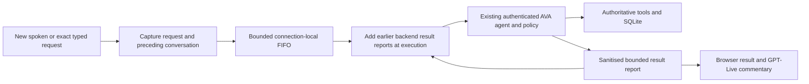

# GPT-Live delegated-work continuity

GPT-Live speaks and listens; the existing authenticated `runVoiceAction` loopback
executes tools in AVA's shared agent. Calendar, Notes and reminder data remain in
their existing authoritative services. This repair adds no direct-execution API,
schema, provider history archive or parallel conversation store.

## Why this exists

The 2026-09-27 calendar session exposed two independent problems: calendar tools
fell through to the unknown-tool approval policy (15 seconds per call), and
queued voice requests lacked the results of work that finished before they ran.
A spoken confirmation repeated two additions; another answer denied an event
that was already stored. Closing the voice connection then aborted unfinished
work. That close is not evidence that the user intentionally pressed Stop.

## Queue and result ownership

- The request/context string is captured when queued. It is not recomposed from
  later speech, which would risk executing a different request.
- Immediately before execution, the next job receives up to **six** earlier
  backend reports from this connection: at most **400 characters** of request
  and **1,200 characters** of result each. The shared Explorer sanitizer runs
  before clipping. Reports are JSON reference data, not new user instructions.
- These are **backend result reports, not independent verification of a write**.
  The agent is instructed not to repeat a completed action to answer a
  confirmation, and to query authoritative tools for uncertain/current state.
- Results returned to the browser and voice provider are sanitized and bounded
  to **1,800 characters**. No raw tool payloads are copied into the report cache.
- Spoken transcript persistence and saved-item/room-post receipts remain on the
  existing path. Reports are not fabricated assistant utterances and are not
  separately persisted. Reconnect starts with an empty report cache; inspect
  the actual calendar/Notes/reminder tools when past completion is uncertain.

## Replay, limits and Stop

Each connection remembers up to **512 distinct delegation IDs** (non-empty,
printable ASCII, at most 128 characters). The exact ID is deduplicated while
queued, running and completed. IDs are never evicted to allow replay. At the
limit, new provider delegations receive an explicit reconnect-required response
and execute nothing. Empty delegations do not repeat an earlier command.

At most **32 jobs** are admitted including active work. Overflow is reported as
not queued, not silently dropped or executed later. This limit also applies to
exact typed input. A new explicit request may be submitted when capacity returns.
Refusal/empty-request notices use the existing browser error/hint frame, not an
action-result frame, so they cannot mark a different running job as finished.

Stop advances a cancellation generation, clears waiting jobs, consumes old
unsubmitted speech and aborts active work. Late steps/results from the old
generation cannot reach the UI/provider or enter completion context. The next
new request is accepted after the active worker settles. An interrupted task is
reported as uncertain: already-executed steps are not rolled back. Socket close
also cancels the queue and ignores subsequent provider events.

## Calendar policy

`calendar_query` is explicitly read-only. `calendar_add` is low risk: it creates
one validated reversible local definition, either a single event or a weekly
series within the existing recurrence bounds. It sends no external invitations
and does not dispatch linked reminders. Both use the existing policy hook;
standing deny rules and hard blocks still win. Service validation is unchanged.

`calendar_update`, `calendar_set_attendance`, `calendar_remind`, unknown tools,
and all global approval timeouts remain unchanged. `watch_list` and
`notes_search` were already read-only. This is not a general permission bypass.

## Tests and limitations

`server/src/routes/voice-live.test.ts` uses fake sockets/deferred workers with an
in-memory authoritative conversation database. It covers FIFO completion
context, capture boundaries, replay/empty/malformed IDs, queue and cache bounds,
sanitization, connection isolation, exact typed input, failures and Stop/close.
`server/src/policy/calendar-runtime.test.ts` exercises the actual policy hook and
Calendar tools against SQLite, including zero approval timers, deny rules and
invalid recurrence/time input. Existing policy and other voice-provider suites
remain regression gates.

These tests prove the handoff mechanics, not perfect speech recognition or
semantic deduplication by an LLM. A *different* delegation ID for an explicit
repeat remains a new request. No event-title guessing or fuzzy calendar
deduplication is added. The cache is bounded and connection-local, not a durable
exactly-once ledger. Existing duplicated/missing user events are not repaired
automatically. Live microphone/provider acceptance must be reported separately;
passing mocks or boot health is not proof of that workflow.
